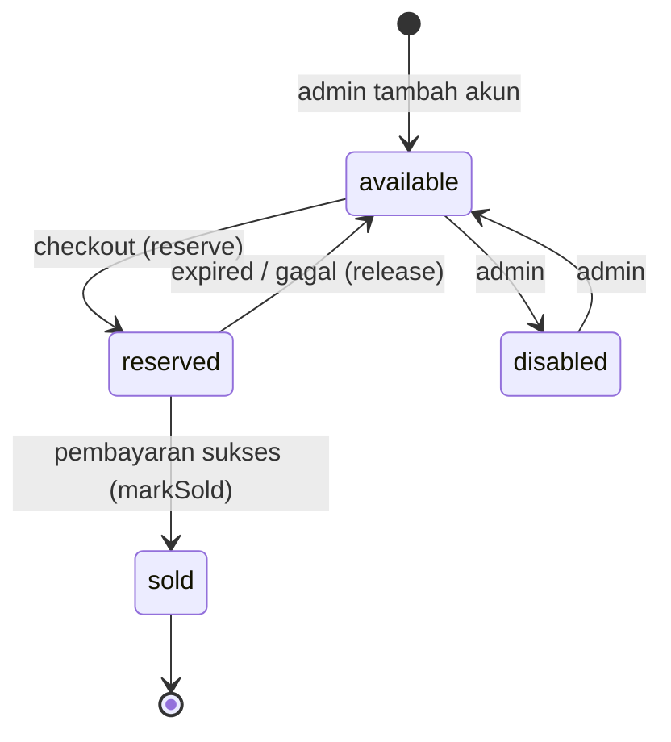
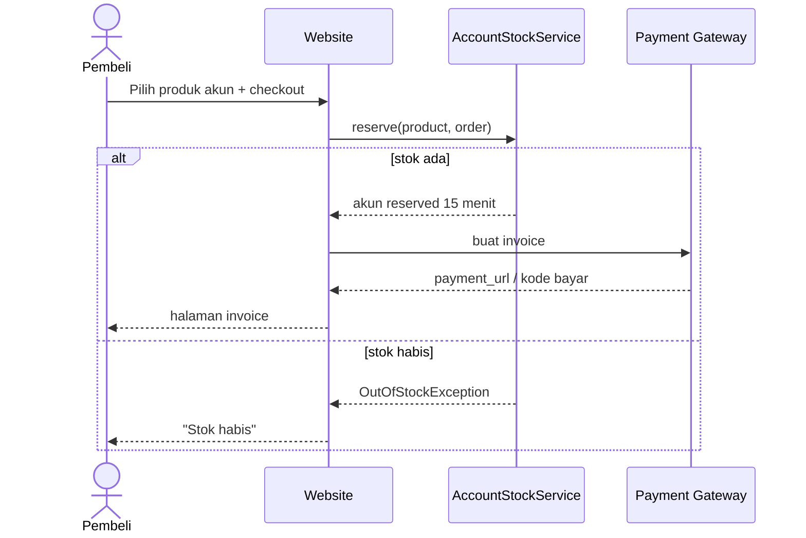
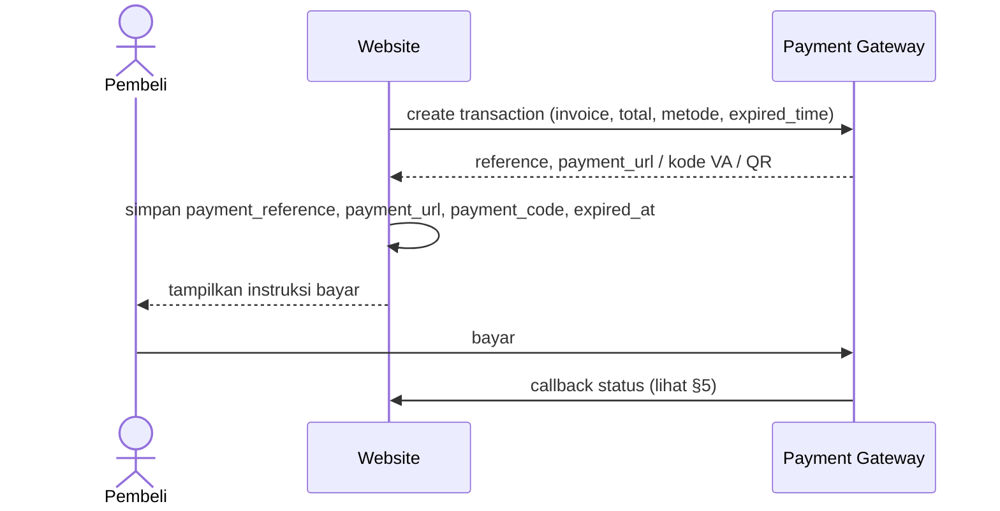
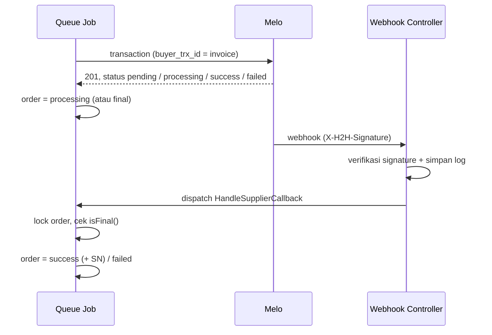
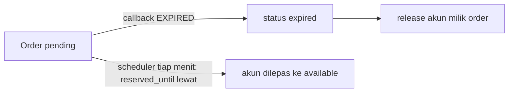

# BUSINESS_FLOW — Alur Bisnis

> Label: **[FINAL] / [REKOMENDASI] / [ASUMSI] / [TBD]** (lihat [`PROJECT_SPEC.md`](PROJECT_SPEC.md)).
> Nama status mengikuti kode: `app/Enums/OrderStatus.php` dan `app/Enums/AccountStatus.php`.
> Label di judul bagian berlaku untuk alur utama bagian itu. Poin di dalamnya yang punya label sendiri ([REKOMENDASI]/[TBD]) mengikuti label tersebut.

## 1. Status yang Dipakai

### Status order (`orders.status`)

| Nilai        | Label UI            | Arti                                       | Final? |
| ------------ | ------------------- | ------------------------------------------ | ------ |
| `pending`    | Menunggu Pembayaran | Order dibuat, invoice payment aktif        | Tidak  |
| `paid`       | Dibayar             | Payment gateway mengonfirmasi lunas        | Tidak  |
| `processing` | Diproses            | Sudah dikirim ke Melo, menunggu hasil      | Tidak  |
| `success`    | Sukses              | Top up terkirim / akun diserahkan          | Ya     |
| `failed`     | Gagal               | Pembayaran gagal atau supplier gagal       | Ya     |
| `expired`    | Kedaluwarsa         | Tidak dibayar sampai batas waktu           | Ya     |
| `refunded`   | Refund              | Dana dikembalikan ([TBD] apakah dipakai)   | Ya     |

Status final tidak boleh diubah oleh callback (`OrderStatus::isFinal()`). [FINAL]

### Status akun (`game_accounts.status`)

| Nilai       | Arti                                        |
| ----------- | ------------------------------------------- |
| `available` | Bisa dibeli, dihitung sebagai stok          |
| `reserved`  | Ditahan untuk satu order yang belum dibayar |
| `sold`      | Sudah terjual                               |
| `disabled`  | Dinonaktifkan admin, tidak dihitung stok    |

## 2. Alur Pembelian Top Up [FINAL]

1. Pembeli membuka halaman game, memilih produk top up.
2. Mengisi User ID (+ Zone ID jika `games.requires_zone_id = true`). Sistem hanya memvalidasi **format** (regex per game), tanpa cek nickname.
3. Login opsional. Guest mengisi email dan/atau WhatsApp ([TBD] mana yang wajib).
4. Memilih metode pembayaran, lalu sistem membuat order `pending` dengan snapshot harga.
5. Sistem meminta invoice ke payment gateway dan mengarahkan pembeli ke halaman invoice.
6. Lanjut ke §4 (pembayaran).

## 3. Alur Pembelian Akun Game [FINAL]

1. Pembeli memilih produk akun. Produk dengan stok 0 tidak bisa dipilih.
2. Sistem membuat order `pending`, lalu memanggil `AccountStockService::reserve()` untuk menahan satu akun (`reserved_until` = sekarang + 15 menit [REKOMENDASI]).
3. Jika stok habis saat itu (`OutOfStockException`), order dibatalkan dan pembeli diberi pesan "stok habis". [REKOMENDASI]
4. Invoice dibuat seperti top up.
5. Pembayaran sukses → `markSold()` → order `success`. Detail akun tampil di invoice ([TBD] aturan akses invoice, lihat `SECURITY_RULES.md`).

## 4. Alur Pembayaran [FINAL]

- Biaya admin payment ditanggung pembeli atau toko: [TBD] (kolom `orders.fee` sudah tersedia).
- Pilihan metode yang ditampilkan: [TBD] (QRIS, VA, e-wallet).

## 5. Alur Callback Payment Gateway [FINAL]

1. Endpoint `POST /webhook/tripay` (`TripayCallbackController`) menerima callback. Jika provider diganti, route dan controller mengikuti provider baru.
2. Verifikasi signature. Jika tidak valid → respons 403 dan dicatat di `api_logs`.
3. Controller mencatat callback, men-dispatch job `HandlePaymentCallback`, lalu langsung membalas sukses. Controller tidak mengubah status order.
4. Job mencari order berdasarkan `merchant_ref` = `orders.invoice` dengan `lockForUpdate()`. Jika order sudah berstatus final → abaikan (idempotent).
5. Job memproses status. Pemrosesan lewat queue = [REKOMENDASI] (`API_INTEGRATION.md` §4); syarat idempotent = [FINAL].

| Status gateway (Tripay) | Status order | Tindakan lanjut               |
| ----------------------- | ------------ | ----------------------------- |
| `PAID` (lunas)          | `paid`       | Isi `paid_at`, lalu lihat (1) |
| `EXPIRED`               | `expired`    | Akun → `release()`            |
| `FAILED`                | `failed`     | Akun → `release()`            |

1. Top up → kirim ke Melo (§6). Akun → `markSold()`, lalu order `success`.

## 6. Alur Pengiriman ke Melo [FINAL]

1. Job mengirim `MeloService::topup($order)` dengan `buyer_trx_id` = invoice.
2. Status order menjadi `processing`, lalu simpan `supplier_reference` / `supplier_status` / `supplier_message`.
3. Respons 201 berarti diterima, bukan selesai: `data.status` biasanya `pending`/`processing`, tetapi bisa sudah final (`success`/`failed`).
4. Jika belum final, tunggu webhook (§7). Cek status ulang (`MeloService::status()` dengan invoice) dilakukan jika webhook tidak datang dalam waktu tertentu ([TBD] interval).
5. Timeout atau error jaringan → retry di queue dengan `buyer_trx_id` yang sama (Melo mengembalikan transaksi yang ada, tanpa debit ganda). Setelah respons 500, cek `status()` dulu sebelum mengulang.

## 7. Alur Callback Supplier [FINAL]

1. `POST /webhook/melo` (`MeloCallbackController`), lalu verifikasi `X-H2H-Signature`. Jika tidak valid → 401 dan dicatat di `api_logs`.
2. Controller menyimpan callback, men-dispatch job `HandleSupplierCallback`, lalu membalas 2xx dengan cepat (Melo menunggu maksimal 10 detik dan mengulang hingga 3 kali).
3. Job mencari order berdasarkan `buyer_trx_id` dengan lock. Jika sudah final → abaikan. Callback yang sama bisa datang berkali-kali.
4. Event `transaction.action_change` (tindakan pelanggan/2FA) → hanya disimpan, tidak menyelesaikan order dan tidak mengubah saldo.
5. Tanpa `event`: `success` → §8. `failed` → §9. `pending`/`processing` → tidak ada perubahan.

## 8. Alur Transaksi Berhasil [FINAL]

- **Top up:** status `success`, `serial_number` diisi SN dari supplier, `completed_at` diisi.
- **Akun:** akun `sold`, order `success`, detail akun tampil di invoice.
- Notifikasi ke pembeli: [TBD] (email/WA).

## 9. Alur Transaksi Gagal

- **Pembayaran gagal:** order `failed`, akun di-`release()`. [FINAL]
- **Supplier gagal setelah dibayar:** order `failed`, pembeli sudah membayar. Saldo Melo yang ditahan dikembalikan otomatis ke toko; yang perlu diputuskan adalah pengembalian ke pembeli. Penanganannya [TBD]:
  - kirim ulang ke supplier (retry manual oleh admin)?
  - refund manual oleh admin di luar sistem?
  - refund lewat payment gateway?
- Admin perlu melihat daftar order gagal yang sudah dibayar (`paid_at` terisi). [REKOMENDASI]

## 10. Alur Expired Payment [FINAL]

- Scheduler `accounts:release-expired` (`routes/console.php`) berjalan tiap menit dan memanggil `AccountStockService::releaseExpired()`.
- Order `pending` yang lewat `expired_at` tanpa callback juga wajib ditandai `expired` [FINAL, `PROJECT_SPEC.md` §12 no. 3]. Mekanismenya (mis. scheduler) [REKOMENDASI]. Belum ada di kode.
- **Masalah terbuka:** `releaseExpired()` saat ini tidak mengecek status order. Jika callback lunas datang setelah reservasi habis, akun bisa sudah dilepas. Lihat [`CURRENT_STATUS.md`](CURRENT_STATUS.md).

## 11. Alur Refund [TBD]

Belum disepakati apakah refund masuk scope. Status `refunded` sudah ada di enum, tetapi belum ada alurnya. Keputusan yang dibutuhkan:

1. Apakah refund dilakukan di sistem atau manual di luar sistem?
2. Siapa yang memicu (admin saja)?
3. Refund ke metode bayar asal atau transfer manual?
