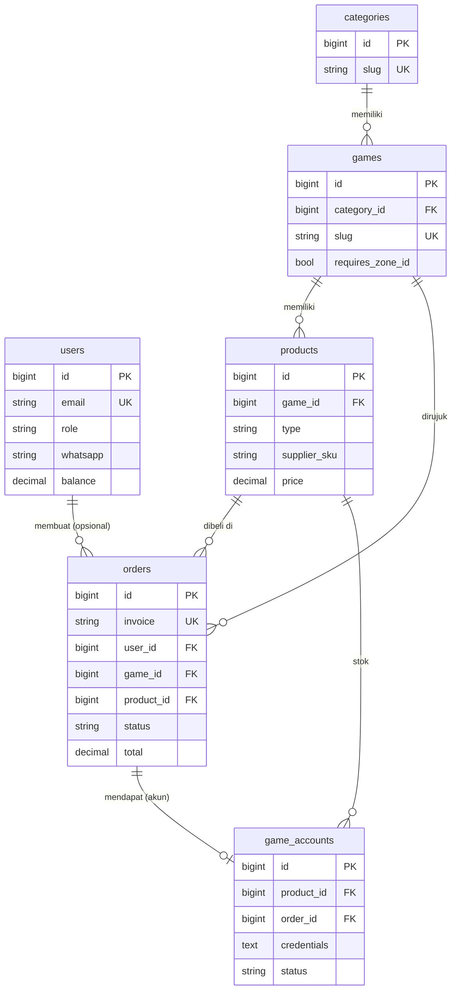

# DATABASE_DESIGN — Rancangan Database

> - Sumber kebenaran skema = migration di `database/migrations/`. Dokumen ini harus diperbarui setiap kali ada migration baru.
> - Prinsip [FINAL]: sesederhana mungkin untuk timeline 1 bulan. **Tidak ada tabel baru yang diusulkan** di luar yang sudah ada.
> - Engine MySQL 8, charset `utf8mb4_unicode_ci`. Uang disimpan sebagai `DECIMAL(15,2)` dalam Rupiah.

## 1. Daftar Entitas

| Tabel           | Fungsi                                        | Migration (1)            |
| --------------- | --------------------------------------------- | ------------------------ |
| `users`         | Admin dan pelanggan                           | `0001…000000` + `000100` |
| `categories`    | Pengelompokan game (Mobile, PC, Voucher, ...) | `000200`                 |
| `games`         | Game yang dijual + aturan input User/Zone ID  | `000300`                 |
| `products`      | Item yang dijual (top up atau akun) + harga   | `000400`                 |
| `orders`        | Transaksi pembelian + data payment & supplier | `000500`                 |
| `game_accounts` | Stok akun game (1 baris = 1 akun)             | `000600`                 |
| `api_logs`      | Log request/callback payment & supplier       | `000700`                 |
| `settings`      | Pengaturan key-value (nama situs, dll.)       | `000800`                 |

Catatan:
1. Nama lengkap file: `database/migrations/2026_11_11_<nomor>_*.php`. Kolom `role`, `whatsapp`, dan `balance` di `users` ditambahkan oleh `2026_11_11_000100_add_role_to_users_table.php`.
- Tabel bawaan Laravel (`0001_01_01_*`): `sessions`, `password_reset_tokens`, `cache`, `cache_locks`, `jobs`, `job_batches`, `failed_jobs`.

## 2. ERD

## 3. Rancangan Tabel

Singkatan: **PK** primary key · **FK** foreign key · **UQ** unique · **IDX** index · **N** nullable.

### `users`

| Kolom               | Tipe            | Keterangan                            |
| ------------------- | --------------- | ------------------------------------- |
| `id`                | BIGINT PK       |                                       |
| `name`              | VARCHAR         |                                       |
| `email`             | VARCHAR UQ      |                                       |
| `whatsapp`          | VARCHAR(20) N   |                                       |
| `email_verified_at` | TIMESTAMP N     | Verifikasi email pelanggan = [TBD]    |
| `password`          | VARCHAR         | Hash (cast `hashed`)                  |
| `role`              | VARCHAR(20) IDX | Default `member` (1)                  |
| `balance`           | DECIMAL(15,2)   | Default 0. **Ditinjau, out of scope** |
| `remember_token`    | VARCHAR N       |                                       |
| timestamps          |                 |                                       |

1. Nilai: `admin` / `member` (pelanggan). Nilai `reseller` ada di enum → **ditinjau, out of scope**.

### `categories`

| Kolom       | Tipe         | Keterangan    |
| ----------- | ------------ | ------------- |
| `id`        | BIGINT PK    |               |
| `name`      | VARCHAR      |               |
| `slug`      | VARCHAR UQ   |               |
| `sort`      | INT UNSIGNED | Urutan tampil |
| `is_active` | BOOLEAN      | Default true  |

### `games`

| Kolom                            | Tipe         | Keterangan                        |
| -------------------------------- | ------------ | --------------------------------- |
| `id`                             | BIGINT PK    |                                   |
| `category_id`                    | FK N         | → `categories.id`, set null (1)   |
| `name`, `publisher`              | VARCHAR      |                                   |
| `slug`                           | VARCHAR UQ   | Dipakai di URL `/game/{slug}`     |
| `thumbnail`, `banner`            | VARCHAR N    | Path file di storage              |
| `description`, `instruction`     | TEXT N       | `instruction` = cara cari User ID |
| `requires_zone_id`               | BOOLEAN      | Mis. MLBB = true                  |
| `user_id_label`                  | VARCHAR      | Default `User ID`                 |
| `zone_id_label`                  | VARCHAR N    |                                   |
| `user_id_regex`, `zone_id_regex` | VARCHAR N    | Validasi format (2)               |
| `is_active`, `is_popular`        | BOOLEAN      |                                   |
| `sort`                           | INT UNSIGNED |                                   |

1. `ON DELETE SET NULL`.
2. Pengganti cek nickname.

### `products`

| Kolom            | Tipe            | Keterangan                             |
| ---------------- | --------------- | -------------------------------------- |
| `id`             | BIGINT PK       |                                        |
| `game_id`        | FK              | → `games.id`, cascade (1)              |
| `type`           | VARCHAR(20) IDX | `topup` / `account`                    |
| `name`           | VARCHAR         |                                        |
| `group`          | VARCHAR N       | Pengelompokan tampilan (Diamond, dll.) |
| `image`          | VARCHAR N       |                                        |
| `description`    | TEXT N          |                                        |
| `supplier`       | VARCHAR N       | `melo` (khusus `topup`)                |
| `supplier_sku`   | VARCHAR N IDX   | `sku_code` Melo                        |
| `base_price`     | DECIMAL(15,2)   | Harga modal                            |
| `price`          | DECIMAL(15,2)   | Harga jual                             |
| `reseller_price` | DECIMAL(15,2) N | **Ditinjau, out of scope**             |
| `strike_price`   | DECIMAL(15,2) N | Harga coret                            |
| `is_active`      | BOOLEAN         |                                        |
| `sort`           | INT UNSIGNED    |                                        |

1. `ON DELETE CASCADE`.
- Index tambahan: UQ(`supplier`, `supplier_sku`) untuk mencegah SKU ganda.

### `orders`

| Kolom                              | Tipe            | Keterangan                           |
| ---------------------------------- | --------------- | ------------------------------------ |
| `id`                               | BIGINT PK       |                                      |
| `invoice`                          | VARCHAR UQ      | Nomor order (1)                      |
| `user_id`                          | FK N            | → `users.id`, set null. NULL = guest |
| `game_id`, `product_id`            | FK              | Restrict (2)                         |
| `product_type`, `product_name`     | VARCHAR         | **Snapshot** saat order              |
| `target_user_id`, `target_zone_id` | VARCHAR N       | Kosong untuk pembelian akun          |
| `email`, `whatsapp`                | VARCHAR N       | Kontak pembeli                       |
| `price`, `fee`, `total`            | DECIMAL(15,2)   | **Snapshot** (3)                     |
| `status`                           | VARCHAR(20) IDX | Default `pending` (4)                |
| `payment_method`                   | VARCHAR N       |                                      |
| `payment_reference`                | VARCHAR N IDX   |                                      |
| `payment_url`, `payment_code`      | TEXT N          | URL checkout / nomor VA / string QR  |
| `paid_at`, `expired_at`            | TIMESTAMP N     |                                      |
| `supplier_reference`               | VARCHAR N IDX   |                                      |
| `supplier_status`                  | VARCHAR N       |                                      |
| `supplier_message`                 | TEXT N          |                                      |
| `serial_number`                    | TEXT N          | SN = bukti top up                    |
| `completed_at`                     | TIMESTAMP N     |                                      |

1. Format `INV{yymmdd}{8 karakter acak}`. Dipakai juga sebagai `merchant_ref` (payment) dan `buyer_trx_id` (Melo).
2. `ON DELETE RESTRICT`: produk/game yang pernah dibeli tidak bisa dihapus.
3. `total = price + fee` [ASUMSI].
4. Daftar status ada di `BUSINESS_FLOW.md` §1.
- Login opsional [FINAL], jadi `user_id` boleh kosong.
- Riwayat transaksi pelanggan = `orders` dengan `user_id` miliknya. Tidak perlu tabel terpisah. [FINAL]

### `game_accounts`

| Kolom            | Tipe        | Keterangan                                 |
| ---------------- | ----------- | ------------------------------------------ |
| `id`             | BIGINT PK   |                                            |
| `product_id`     | FK          | → `products.id`, cascade. Produk `account` |
| `credentials`    | TEXT        | **Terenkripsi** (1)                        |
| `public_info`    | TEXT N      | Boleh tampil publik (rank, skin)           |
| `status`         | VARCHAR(20) | Default `available` (2)                    |
| `order_id`       | FK N        | → `orders.id`, set null (3)                |
| `reserved_until` | TIMESTAMP N | Batas penahanan                            |
| `sold_at`        | TIMESTAMP N |                                            |

1. Cast `encrypted` (kunci `APP_KEY`), disembunyikan dari serialisasi (`#[Hidden]`).
2. `available` / `reserved` / `sold` / `disabled`.
3. Order yang sedang menahan atau sudah membeli akun.
- Index: (`product_id`, `status`) untuk hitung stok & ambil akun tersedia.
- Index: (`status`, `reserved_until`) untuk scheduler release.

### `api_logs`

| Kolom                 | Tipe          | Keterangan              |
| --------------------- | ------------- | ----------------------- |
| `provider`            | VARCHAR(30)   | `tripay` / `melo`       |
| `direction`           | VARCHAR(10)   | `outgoing` / `callback` |
| `reference`           | VARCHAR N IDX | Invoice                 |
| `endpoint`            | VARCHAR N     |                         |
| `request`, `response` | JSON N        | **Tanpa** secret/sign   |
| `signature_valid`     | BOOLEAN N     |                         |
| `http_status`         | SMALLINT N    |                         |

- Masa simpan log: [TBD] (rekomendasi: hapus setelah 90 hari).

### `settings`

| Kolom   | Tipe       | Keterangan |
| ------- | ---------- | ---------- |
| `key`   | VARCHAR UQ |            |
| `value` | TEXT N     |            |

- Diakses lewat `Setting::get()` dengan cache.
- Isi yang dibutuhkan (nama situs, kontak CS, dll.): [TBD].

## 4. Aturan Penyimpanan Data [FINAL]

1. Harga & nama produk di `orders` adalah snapshot. Perubahan harga produk tidak memengaruhi order lama.
2. Data login akun hanya di `game_accounts.credentials` (terenkripsi). Jangan disalin ke `orders`, log, atau email dalam bentuk teks biasa tanpa persetujuan.
3. `APP_KEY` production wajib dibackup. Jika hilang, kredensial akun tidak bisa dibaca lagi.
4. Status disimpan sebagai string dan di-cast ke enum PHP (`app/Enums`). Nilai baru harus ditambahkan di enum terlebih dahulu.
5. Produk yang sudah pernah dibeli tidak dihapus. Nonaktifkan dengan `is_active = false` (FK `RESTRICT`).

## 5. Aturan Transaksi Database [FINAL]

- Perubahan yang melibatkan lebih dari satu tabel (order + akun, order + status payment) wajib di dalam `DB::transaction`.
- Update status order dari callback: ambil order dengan `lockForUpdate()`, cek `status->isFinal()`, baru ubah. [REKOMENDASI] untuk job yang akan dibuat.
- Panggilan HTTP ke pihak luar **tidak** boleh berada di dalam transaksi DB yang memegang lock.

## 6. Perlindungan Stok (Anti Jual Ganda) [FINAL]

Diimplementasikan di `app/Services/AccountStockService.php`:

| Metode             | Perilaku                                                   |
| ------------------ | ---------------------------------------------------------- |
| `reserve()`        | Kunci 1 akun `available` → `reserved` untuk order (1)      |
| `markSold()`       | Akun milik order → `sold`, isi `sold_at`. Idempotent       |
| `release()`        | Akun `reserved` milik order → `available`                  |
| `releaseExpired()` | Semua `reserved` yang lewat `reserved_until` → `available` |

1. Di dalam transaksi + `lockForUpdate()`. Mengisi `order_id` dan `reserved_until`. Jika tidak ada stok → `OutOfStockException`.

- Dites di `tests/Feature/AccountStockServiceTest.php` (MySQL, termasuk kasus dua order tidak mendapat akun yang sama).
- **Masalah terbuka:** `releaseExpired()` belum mengecek status order (lihat `CURRENT_STATUS.md`).

## 7. Item Ditinjau / TBD

| Item                        | Status                              |
| --------------------------- | ----------------------------------- |
| Kolom & role reseller (1)   | Out of scope. Hapus/biarkan = [TBD] |
| Verifikasi email pelanggan  | [TBD]                               |
| Masa simpan `api_logs`      | [TBD]                               |
| Kolom tambahan untuk refund | [TBD], tunggu alur refund           |

1. `users.balance`, `products.reseller_price`, role `reseller`, `Product::priceFor()`.
