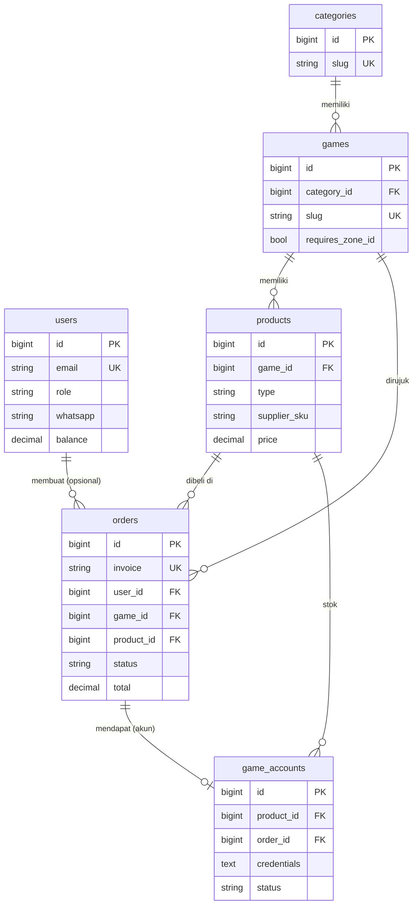

# DATABASE_DESIGN — Rancangan Database

> Sumber kebenaran skema = migration di `database/migrations/`. Dokumen ini harus diperbarui setiap kali ada migration baru.
> Prinsip [FINAL]: sesederhana mungkin untuk 21 hari. **Tidak ada tabel baru yang diusulkan** di luar yang sudah ada.
> Engine MySQL 8, charset `utf8mb4_unicode_ci`. Uang disimpan sebagai `DECIMAL(15,2)` dalam Rupiah.

## 1. Daftar Entitas

| Tabel | Fungsi | Migration |
|---|---|---|
| `users` | Admin dan pelanggan | `0001_01_01_000000_*` + `2026_11_11_000100_add_role_to_users_table.php` |
| `categories` | Pengelompokan game (Mobile, PC, Voucher, ...) | `2026_11_11_000200_*` |
| `games` | Game yang dijual + aturan input User/Zone ID | `2026_11_11_000300_*` |
| `products` | Item yang dijual (top up atau akun) + harga | `2026_11_11_000400_*` |
| `orders` | Transaksi pembelian, termasuk data payment & supplier | `2026_11_11_000500_*` |
| `game_accounts` | Stok akun game (1 baris = 1 akun) | `2026_11_11_000600_*` |
| `api_logs` | Log request/callback ke payment & supplier | `2026_11_11_000700_*` |
| `settings` | Pengaturan key-value (nama situs, dll.) | `2026_11_11_000800_*` |
| `sessions`, `password_reset_tokens`, `cache`, `cache_locks`, `jobs`, `job_batches`, `failed_jobs` | Tabel bawaan Laravel | `0001_01_01_*` |

## 2. ERD

## 3. Rancangan Tabel

### `users`
| Kolom | Tipe | Keterangan |
|---|---|---|
| `id` | BIGINT PK | |
| `name` | VARCHAR | |
| `email` | VARCHAR, UNIQUE | |
| `whatsapp` | VARCHAR(20), NULL | |
| `email_verified_at` | TIMESTAMP, NULL | Verifikasi email pelanggan = [TBD] |
| `password` | VARCHAR | Hash (cast `hashed`) |
| `role` | VARCHAR(20), default `member`, INDEX | `admin` / `member` (pelanggan). `reseller` ada di enum → **ditinjau, out of scope** |
| `balance` | DECIMAL(15,2), default 0 | **Ditinjau, out of scope** (terkait reseller/saldo) |
| `remember_token`, timestamps | | |

### `categories`
| Kolom | Tipe | Keterangan |
|---|---|---|
| `id` | BIGINT PK | |
| `name` | VARCHAR | |
| `slug` | VARCHAR, UNIQUE | |
| `sort` | INT UNSIGNED, default 0 | Urutan tampil |
| `is_active` | BOOLEAN, default true | |

### `games`
| Kolom | Tipe | Keterangan |
|---|---|---|
| `id` | BIGINT PK | |
| `category_id` | FK → `categories.id`, NULL, `ON DELETE SET NULL` | |
| `name`, `publisher` | VARCHAR | |
| `slug` | VARCHAR, UNIQUE | Dipakai di URL `/game/{slug}` |
| `thumbnail`, `banner` | VARCHAR, NULL | Path file di storage |
| `description`, `instruction` | TEXT, NULL | `instruction` = cara menemukan User ID |
| `requires_zone_id` | BOOLEAN | Mis. MLBB = true |
| `user_id_label` | VARCHAR, default `User ID` | |
| `zone_id_label` | VARCHAR, NULL | |
| `user_id_regex`, `zone_id_regex` | VARCHAR, NULL | Validasi format (pengganti cek nickname) |
| `is_active`, `is_popular` | BOOLEAN | |
| `sort` | INT UNSIGNED | |

### `products`
| Kolom | Tipe | Keterangan |
|---|---|---|
| `id` | BIGINT PK | |
| `game_id` | FK → `games.id`, `ON DELETE CASCADE` | |
| `type` | VARCHAR(20), INDEX | `topup` / `account` |
| `name`, `group` | VARCHAR | `group` = pengelompokan tampilan (Diamond, Weekly Pass, ...) |
| `image` | VARCHAR, NULL | |
| `description` | TEXT, NULL | |
| `supplier` | VARCHAR, NULL | `digiflazz` (khusus `topup`) |
| `supplier_sku` | VARCHAR, NULL, INDEX | `buyer_sku_code` Digiflazz |
| `base_price` | DECIMAL(15,2) | Harga modal |
| `price` | DECIMAL(15,2) | Harga jual |
| `reseller_price` | DECIMAL(15,2), NULL | **Ditinjau, out of scope** |
| `strike_price` | DECIMAL(15,2), NULL | Harga coret |
| `is_active`, `sort` | | |
| | UNIQUE(`supplier`, `supplier_sku`) | Mencegah SKU ganda |

### `orders`
| Kolom | Tipe | Keterangan |
|---|---|---|
| `id` | BIGINT PK | |
| `invoice` | VARCHAR, UNIQUE | Format `INV{yymmdd}{8 random}`. Dipakai sebagai `merchant_ref` dan `ref_id` |
| `user_id` | FK → `users.id`, NULL, `ON DELETE SET NULL` | NULL = guest (login opsional [FINAL]) |
| `game_id`, `product_id` | FK, `ON DELETE RESTRICT` | Produk/game yang pernah dibeli tidak bisa dihapus |
| `product_type`, `product_name` | VARCHAR | **Snapshot** saat order |
| `target_user_id`, `target_zone_id` | VARCHAR, NULL | Kosong untuk pembelian akun |
| `email`, `whatsapp` | VARCHAR, NULL | Kontak pembeli |
| `price`, `fee`, `total` | DECIMAL(15,2) | **Snapshot**. `total = price + fee` [ASUMSI] |
| `status` | VARCHAR(20), INDEX, default `pending` | Lihat `BUSINESS_FLOW.md` §1 |
| `payment_method`, `payment_reference` (INDEX) | VARCHAR, NULL | |
| `payment_url`, `payment_code` | TEXT, NULL | URL checkout / nomor VA / string QR |
| `paid_at`, `expired_at` | TIMESTAMP, NULL | |
| `supplier_reference` (INDEX), `supplier_status` | VARCHAR, NULL | |
| `supplier_message`, `serial_number` | TEXT, NULL | SN = bukti top up |
| `completed_at` | TIMESTAMP, NULL | |

Riwayat transaksi pelanggan = `orders` dengan `user_id` miliknya. Tidak perlu tabel terpisah. [FINAL]

### `game_accounts`
| Kolom | Tipe | Keterangan |
|---|---|---|
| `id` | BIGINT PK | |
| `product_id` | FK → `products.id`, `ON DELETE CASCADE` | Produk ber-`type = account` |
| `credentials` | TEXT | **Terenkripsi** (cast `encrypted`, kunci `APP_KEY`). Disembunyikan dari serialisasi (`#[Hidden]`). |
| `public_info` | TEXT, NULL | Boleh tampil publik (rank, skin) |
| `status` | VARCHAR(20), default `available` | `available` / `reserved` / `sold` / `disabled` |
| `order_id` | FK → `orders.id`, NULL, `ON DELETE SET NULL` | Order yang menahan/membeli |
| `reserved_until` | TIMESTAMP, NULL | Batas penahanan |
| `sold_at` | TIMESTAMP, NULL | |
| | INDEX(`product_id`, `status`) | Hitung stok & ambil akun tersedia |
| | INDEX(`status`, `reserved_until`) | Scheduler release |

### `api_logs`
| Kolom | Tipe | Keterangan |
|---|---|---|
| `provider` | VARCHAR(30) | `tripay` / `digiflazz` |
| `direction` | VARCHAR(10) | `outgoing` / `callback` |
| `reference` | VARCHAR, NULL, INDEX | Invoice |
| `endpoint` | VARCHAR, NULL | |
| `request`, `response` | JSON, NULL | **Tanpa** secret/sign |
| `signature_valid` | BOOLEAN, NULL | |
| `http_status` | SMALLINT, NULL | |

Masa simpan log: [TBD] (rekomendasi: hapus setelah 90 hari).

### `settings`
`key` (UNIQUE), `value` (TEXT). Diakses lewat `Setting::get()` dengan cache. Isi yang dibutuhkan (nama situs, kontak CS, dll.): [TBD].

## 4. Aturan Penyimpanan Data [FINAL]

1. Harga & nama produk di `orders` adalah snapshot. Perubahan harga produk tidak memengaruhi order lama.
2. Data login akun hanya di `game_accounts.credentials` (terenkripsi). Jangan disalin ke `orders`, log, atau email dalam bentuk teks biasa tanpa persetujuan.
3. `APP_KEY` production wajib dibackup. Jika hilang, kredensial akun tidak bisa dibaca lagi.
4. Status disimpan sebagai string dan di-cast ke enum PHP (`app/Enums`). Nilai baru harus ditambahkan di enum terlebih dahulu.
5. Produk yang sudah pernah dibeli tidak dihapus. Nonaktifkan dengan `is_active = false` (FK `RESTRICT`).

## 5. Aturan Transaksi Database [FINAL]

- Perubahan yang melibatkan lebih dari satu tabel (order + akun, order + status payment) wajib di dalam `DB::transaction`.
- Update status order dari callback: ambil order dengan `lockForUpdate()`, cek `status->isFinal()`, baru ubah. [REKOMENDASI] untuk job yang akan dibuat.
- Panggilan HTTP ke pihak luar **tidak** boleh berada di dalam transaksi DB yang memegang lock.

## 6. Perlindungan Stok (Anti Jual Ganda) [FINAL]

Diimplementasikan di `app/Services/AccountStockService.php`:

| Metode | Perilaku |
|---|---|
| `reserve($product, $order)` | Transaksi + `lockForUpdate()` pada akun `available` pertama, lalu set `reserved`, `order_id`, dan `reserved_until`. Jika tidak ada → `OutOfStockException`. |
| `markSold($order)` | Transaksi + lock, set `sold`, `sold_at`. Idempotent (akun yang sudah sold tidak diubah). |
| `release($order)` | Akun `reserved` milik order kembali ke `available`. |
| `releaseExpired()` | Semua akun `reserved` dengan `reserved_until` yang sudah lewat kembali ke `available`. |

Dites di `tests/Feature/AccountStockServiceTest.php` (MySQL, termasuk kasus dua order tidak mendapat akun yang sama).

**Masalah terbuka:** `releaseExpired()` belum mengecek status order (lihat `CURRENT_STATUS.md`).

## 7. Item Ditinjau / TBD

| Item | Status |
|---|---|
| `users.balance`, `products.reseller_price`, role `reseller`, `Product::priceFor()` | Out of scope. Hapus atau biarkan = [TBD] keputusan PO |
| Verifikasi email pelanggan | [TBD] |
| Masa simpan `api_logs` | [TBD] |
| Kolom tambahan untuk refund | [TBD] (tunggu keputusan alur refund) |
