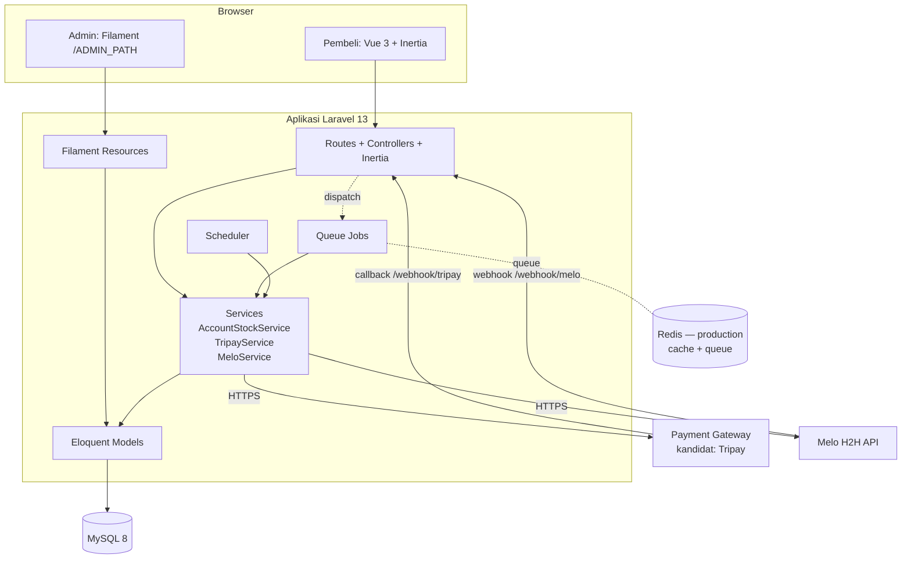

# SYSTEM_ARCHITECTURE — Arsitektur Sistem

> Prinsip [FINAL]: **satu aplikasi Laravel monolith**. Tidak ada microservices, tidak ada SPA/API terpisah.

## 1. Gambaran Umum



## 2. Peran Komponen

| Komponen       | Peran                                                    | Status |
| -------------- | -------------------------------------------------------- | ------ |
| Laravel        | Routing, auth, validasi, Eloquent, queue, HTTP, enkripsi | ✅     |
| Filament 5     | Seluruh panel admin di `/{ADMIN_PATH}` (1)               | ✅     |
| Inertia.js 3   | Jembatan controller Laravel ↔ halaman Vue, tanpa API (2) | ✅     |
| Vue 3          | Halaman & komponen storefront, JavaScript (3)            | ✅     |
| Blade          | Hanya root view `resources/views/app.blade.php` (4)      | ✅     |
| Tailwind CSS 4 | Styling storefront (`resources/css/app.css`) (5)         | ✅     |
| Services       | Logika bisnis & integrasi eksternal (6)                  | ✅     |
| Queue Jobs     | Callback payment, kirim ke Melo, notifikasi         | ➕     |
| Scheduler      | `accounts:release-expired` tiap menit                    | ✅     |

✅ ada di kode · ➕ direkomendasikan, belum dibuat.

1. CRUD katalog, stok akun, pesanan, dashboard. Akses dibatasi `User::canAccessPanel()` (role admin).
2. Middleware `App\Http\Middleware\HandleInertiaRequests` (grup `web`) membagikan `appName` dan `links`. Checkout nanti dikirim sebagai form Inertia ke controller.
3. `resources/js/pages/*.vue`, `resources/js/layouts/AppLayout.vue`, `resources/js/components/*.vue`. Props dari controller berupa array eksplisit (lihat `SECURITY_RULES.md` §11).
4. Filament tetap memakai Livewire/Blade miliknya sendiri; storefront tidak memakai Livewire.
5. Admin memakai styling bawaan Filament.
6. Folder `app/Services`. Controller dan Job memanggil service, bukan memanggil API langsung.
- Scheduler didaftarkan di `routes/console.php`.

## 3. Komunikasi Frontend ↔ Backend

- Storefront memakai Inertia: kunjungan pertama mengembalikan HTML berisi data halaman (JSON), navigasi berikutnya lewat request Inertia ke route yang sama. Tidak ada REST API publik dan tidak ada SPA terpisah. [FINAL]
- Admin sepenuhnya lewat Filament (Livewire bawaan Filament), di path `ADMIN_PATH`. [FINAL]
- Endpoint non-HTML hanya webhook: `POST /webhook/tripay`, `POST /webhook/melo`. Keduanya dikecualikan dari CSRF (`bootstrap/app.php`) dan diberi throttle. [FINAL]

## 4. Database, Cache, Queue

| Kebutuhan | Development           | Production               |
| --------- | --------------------- | ------------------------ |
| Database  | MySQL 8 (Laragon) (1) | MySQL 8 di VPS           |
| Cache     | `database`            | Redis [FINAL]            |
| Queue     | `database`            | Redis [FINAL] (2)        |
| Session   | `database`            | `database` / Redis [TBD] |
| Mail      | `log`                 | SMTP / Resend [TBD]      |

1. Database `topup_game`; test memakai `topup_game_test`.
2. Worker: `php artisan queue:work --tries=3`. Horizon = [TBD] (dependency baru).

## 5. Integrasi Eksternal

- **Payment gateway:** `app/Services/Payment/TripayService.php` (kandidat). Jika provider berubah, buat service baru dengan metode yang setara (buat transaksi, verifikasi callback). Controller dan job tidak boleh bergantung pada detail Tripay. [REKOMENDASI]
- **Melo:** `app/Services/Supplier/MeloService.php`.
- Konfigurasi di `config/services.php` (`services.tripay.*`, `services.melo.*`), nilai dari `.env`.
- Detail ada di [`API_INTEGRATION.md`](API_INTEGRATION.md).

## 6. Struktur Direktori

Status: ✅ ada di kode · ➕ direkomendasikan untuk dibuat (lokasi yang harus dipakai).

```
app/
├── Console/Commands/ReleaseExpiredAccounts.php      ✅ accounts:release-expired
├── Enums/                                          ✅ ProductType, OrderStatus, AccountStatus, UserRole
├── Exceptions/OutOfStockException.php               ✅
├── Filament/
│   ├── Resources/                                  ✅ Categories, Games, Products, GameAccounts, Orders
│   │   └── Users/ (Pelanggan)                      ➕
│   └── Widgets/StoreOverview.php                   ✅
├── Http/
│   ├── Controllers/StorefrontController.php        ✅ home, game, invoice (Inertia)
│   ├── Controllers/CheckoutController.php          ➕ terima form checkout Inertia
│   ├── Middleware/HandleInertiaRequests.php        ✅ shared props
│   ├── Controllers/Webhook/                        ✅ TripayCallbackController, MeloCallbackController
│   ├── Controllers/Auth/ (login/register pelanggan) ➕
│   └── Requests/                                   ➕ Form Request validasi
├── Jobs/                                           ➕ HandlePaymentCallback, SendTopupToSupplier, HandleSupplierCallback
├── Models/                                         ✅ User, Category, Game, Product, GameAccount, Order, ApiLog, Setting
├── Notifications/ atau Mail/                       ➕ jika notifikasi disetujui
├── Providers/Filament/AdminPanelProvider.php       ✅
└── Services/
    ├── AccountStockService.php                     ✅
    ├── Payment/TripayService.php                   ✅
    └── Supplier/MeloService.php                    ✅
database/
├── migrations/2026_11_11_*                         ✅ lihat DATABASE_DESIGN.md
├── factories/                                      ✅ satu per model
└── seeders/DatabaseSeeder.php                      ✅ admin + data contoh
resources/js/
├── app.js                                          ✅ createInertiaApp
├── pages/{Home,Game,Invoice}.vue                   ✅
├── layouts/AppLayout.vue                           ✅
└── components/                                     ✅ GameCover, StatusBadge, CopyButton
resources/views/app.blade.php                       ✅ root view Inertia
routes/
├── web.php                                         ✅ storefront + webhook
└── console.php                                     ✅ scheduler
tests/Feature/                                      ✅ AccountStockService, WebhookSignature, Storefront, AdminPanelAccess, MeloService
```

Aturan: jangan membuat folder dasar baru di luar daftar ini tanpa persetujuan.

## 7. Route Aktual

| Method | URL                  | Nama                | Handler                        |
| ------ | -------------------- | ------------------- | ------------------------------ |
| GET    | `/`                  | `home`              | `StorefrontController@home`    |
| GET    | `/game/{game}`       | `game.show`         | `StorefrontController@game`    |
| GET    | `/invoice/{order}`   | `invoice.show`      | `StorefrontController@invoice` |
| POST   | `/webhook/tripay`    | `webhook.tripay`    | `TripayCallbackController`     |
| POST   | `/webhook/melo` | `webhook.melo` | `MeloCallbackController`  |
| —      | `/{ADMIN_PATH}/*`    | `filament.admin.*`  | Filament                       |

- `{game}` dicari berdasarkan `slug`; `{order}` dicari berdasarkan `invoice`.

Cek terbaru: `php artisan route:list --except-vendor`.

## 8. Menjalankan Lokal (Laragon)

Nyalakan MySQL di Laragon (**Start All**). Database `topup_game` dan `topup_game_test` dibuat dengan `utf8mb4_unicode_ci`.

```bash
composer install
npm install
cp .env.example .env          # isi kredensial sandbox (jangan commit)
php artisan key:generate
php artisan migrate --seed    # admin contoh: admin@example.com / password (khusus lokal)
npm run build                 # atau: composer run dev
php artisan serve
php artisan schedule:work     # terminal terpisah, untuk release stok akun
php artisan queue:work        # terminal terpisah, setelah job dibuat
php artisan test --compact
```

## 9. Deploy [TBD detail]

- VPS + Coolify **atau** Laravel Forge, dengan Cloudflare di depan (DNS, SSL, proteksi). Pilihan Coolify vs Forge = [TBD].
- Wajib di server: cron `schedule:run` tiap menit, queue worker sebagai service, Redis, backup database harian [REKOMENDASI].
- URL webhook production harus didaftarkan di dashboard payment gateway dan Melo.
