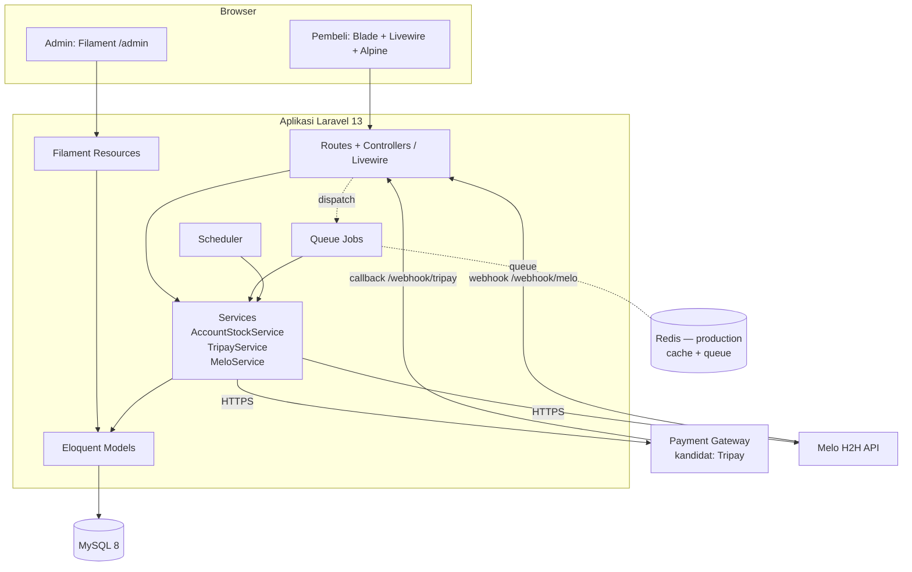

# SYSTEM_ARCHITECTURE — Arsitektur Sistem

> Prinsip [FINAL]: **satu aplikasi Laravel monolith**. Tidak ada microservices, tidak ada SPA/API terpisah.

## 1. Gambaran Umum



## 2. Peran Komponen

| Komponen | Peran |
|---|---|
| **Laravel** | Routing, auth, validasi, Eloquent, queue, scheduler, HTTP client, enkripsi |
| **Filament 5** | Seluruh panel admin di `/admin`: CRUD katalog, stok akun, pesanan, dashboard. Akses dibatasi `User::canAccessPanel()` (role admin). |
| **Blade** | Layout dan halaman storefront (`resources/views/storefront/*`, `resources/views/components/layouts/app.blade.php`) |
| **Livewire** | Bagian interaktif storefront, terutama form checkout (pilih produk, input ID, metode bayar, total). [REKOMENDASI] Belum dibuat. |
| **Alpine.js** | Interaksi kecil di sisi klien (toggle, copy kode bayar, modal). Ikut terpasang bersama Livewire. |
| **Tailwind CSS 4** | Styling storefront (`resources/css/app.css`). Admin memakai styling Filament. |
| **Services** (`app/Services`) | Logika bisnis dan integrasi eksternal. Controller, Livewire, dan Job memanggil service, bukan memanggil API langsung. |
| **Queue Jobs** | Proses callback payment, pengiriman ke Melo, callback supplier, notifikasi. [REKOMENDASI] Belum dibuat. |
| **Scheduler** | `accounts:release-expired` tiap menit (`routes/console.php`) |

## 3. Komunikasi Frontend ↔ Backend

- Storefront dirender di server (Blade). Interaksi checkout lewat Livewire, tanpa REST API publik. [FINAL]
- Admin sepenuhnya lewat Filament (Livewire). [FINAL]
- Endpoint non-HTML hanya webhook: `POST /webhook/tripay`, `POST /webhook/melo`. Keduanya dikecualikan dari CSRF (`bootstrap/app.php`) dan diberi throttle. [FINAL]

## 4. Database, Cache, Queue

| Kebutuhan | Development | Production |
|---|---|---|
| Database | MySQL 8 (Laragon), DB `topup_game`; test: `topup_game_test` | MySQL 8 di VPS |
| Cache | `database` | Redis [FINAL] |
| Queue | `database` | Redis [FINAL]. Worker: `php artisan queue:work --tries=3`. Horizon = [TBD] (dependency baru). |
| Session | `database` | `database` atau Redis [TBD] |
| Mail | `log` | SMTP / Resend [TBD] |

## 5. Integrasi Eksternal

- **Payment gateway:** `app/Services/Payment/TripayService.php` (kandidat). Jika provider berubah, buat service baru dengan metode yang setara (buat transaksi, verifikasi callback). Controller dan job tidak boleh bergantung pada detail Tripay. [REKOMENDASI]
- **Melo:** `app/Services/Supplier/MeloService.php`.
- Konfigurasi di `config/services.php` (`services.tripay.*`, `services.melo.*`), nilai dari `.env`.
- Detail ada di [`API_INTEGRATION.md`](API_INTEGRATION.md).

## 6. Struktur Direktori

Status: ✅ ada di kode · ➕ direkomendasikan untuk dibuat (lokasi yang harus dipakai).

```
app/
├── Console/Commands/ReleaseExpiredAccounts.php      ✅ accounts:release-expired
├── Enums/                                          ✅ ProductType, OrderStatus, AccountStatus, UserRole
├── Exceptions/OutOfStockException.php               ✅
├── Filament/
│   ├── Resources/                                  ✅ Categories, Games, Products, GameAccounts, Orders
│   │   └── Users/ (Pelanggan)                      ➕
│   └── Widgets/StoreOverview.php                   ✅
├── Http/
│   ├── Controllers/StorefrontController.php        ✅ home, game, invoice
│   ├── Controllers/Webhook/                        ✅ TripayCallbackController, MeloCallbackController
│   ├── Controllers/Auth/ (login/register pelanggan) ➕
│   └── Requests/                                   ➕ Form Request validasi
├── Jobs/                                           ➕ HandlePaymentCallback, SendTopupToSupplier, HandleSupplierCallback
├── Livewire/Checkout.php                           ➕
├── Models/                                         ✅ User, Category, Game, Product, GameAccount, Order, ApiLog, Setting
├── Notifications/ atau Mail/                       ➕ jika notifikasi disetujui
├── Providers/Filament/AdminPanelProvider.php       ✅
└── Services/
    ├── AccountStockService.php                     ✅
    ├── Payment/TripayService.php                   ✅
    └── Supplier/MeloService.php               ✅
database/
├── migrations/2026_11_11_*                         ✅ lihat DATABASE_DESIGN.md
├── factories/                                      ✅ satu per model
└── seeders/DatabaseSeeder.php                      ✅ admin + data contoh
resources/views/
├── components/layouts/app.blade.php                ✅
├── storefront/{home,game,invoice}.blade.php        ✅
└── livewire/                                       ➕
routes/
├── web.php                                         ✅ storefront + webhook
└── console.php                                     ✅ scheduler
tests/Feature/                                      ✅ AccountStockService, WebhookSignature, Storefront, AdminPanelAccess
```

Aturan: jangan membuat folder dasar baru di luar daftar ini tanpa persetujuan.

## 7. Route Aktual

| Method | URL | Nama | Handler |
|---|---|---|---|
| GET | `/` | `home` | `StorefrontController@home` |
| GET | `/game/{game}` (binding by `slug`) | `game.show` | `StorefrontController@game` |
| GET | `/invoice/{order}` (binding by `invoice`) | `invoice.show` | `StorefrontController@invoice` |
| POST | `/webhook/tripay` | `webhook.tripay` | `TripayCallbackController` |
| POST | `/webhook/melo` | `webhook.melo` | `MeloCallbackController` |
| — | `/admin/*` | `filament.admin.*` | Filament |

Cek terbaru: `php artisan route:list --except-vendor`.

## 8. Menjalankan Lokal (Laragon)

Nyalakan MySQL di Laragon (**Start All**). Database `topup_game` dan `topup_game_test` dibuat dengan `utf8mb4_unicode_ci`.

```bash
composer install
npm install
cp .env.example .env          # isi kredensial sandbox (jangan commit)
php artisan key:generate
php artisan migrate --seed    # admin contoh: admin@example.com / password (khusus lokal)
npm run build                 # atau: composer run dev
php artisan serve
php artisan schedule:work     # terminal terpisah, untuk release stok akun
php artisan queue:work        # terminal terpisah, setelah job dibuat
php artisan test --compact
```

## 9. Deploy [TBD detail]

- VPS + Coolify **atau** Laravel Forge, dengan Cloudflare di depan (DNS, SSL, proteksi). Pilihan Coolify vs Forge = [TBD].
- Wajib di server: cron `schedule:run` tiap menit, queue worker sebagai service, Redis, backup database harian [REKOMENDASI].
- URL webhook production harus didaftarkan di dashboard payment gateway dan Melo.
